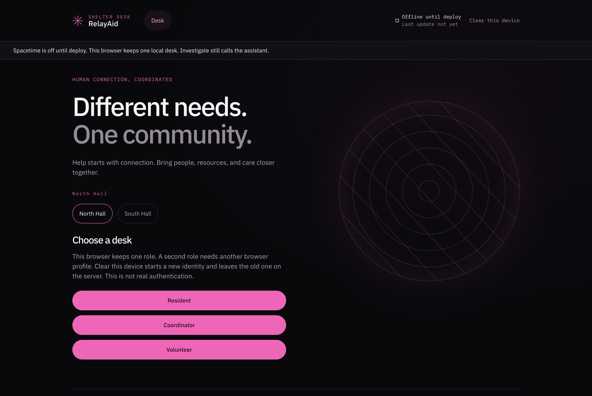
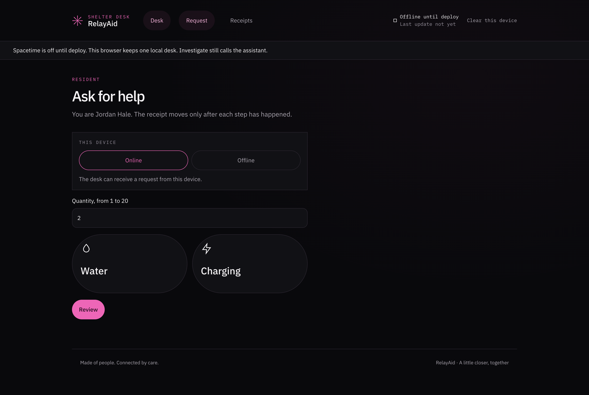
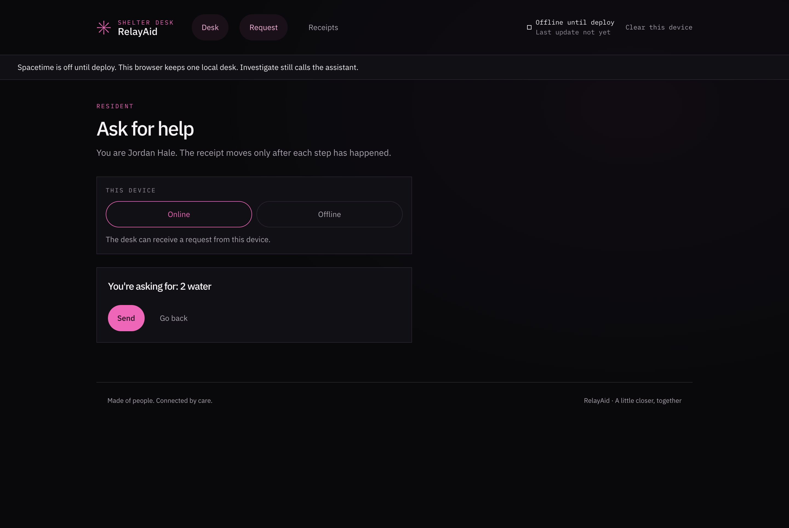
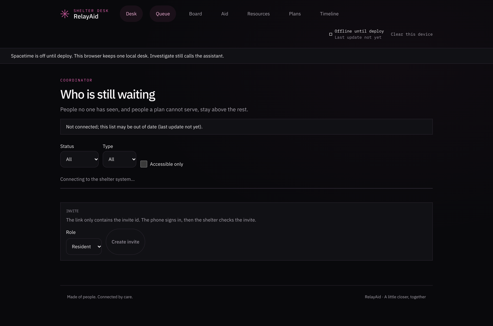
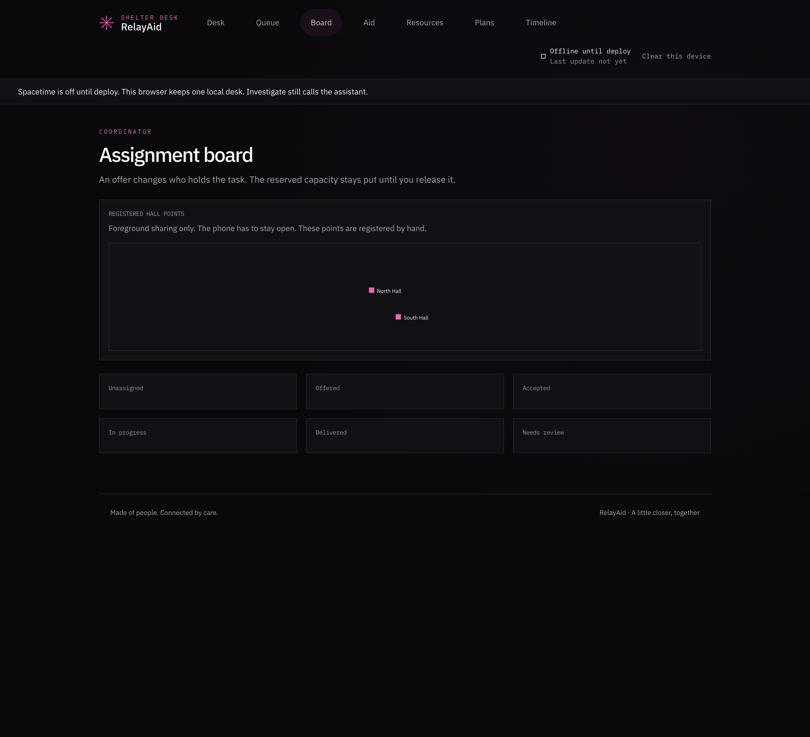
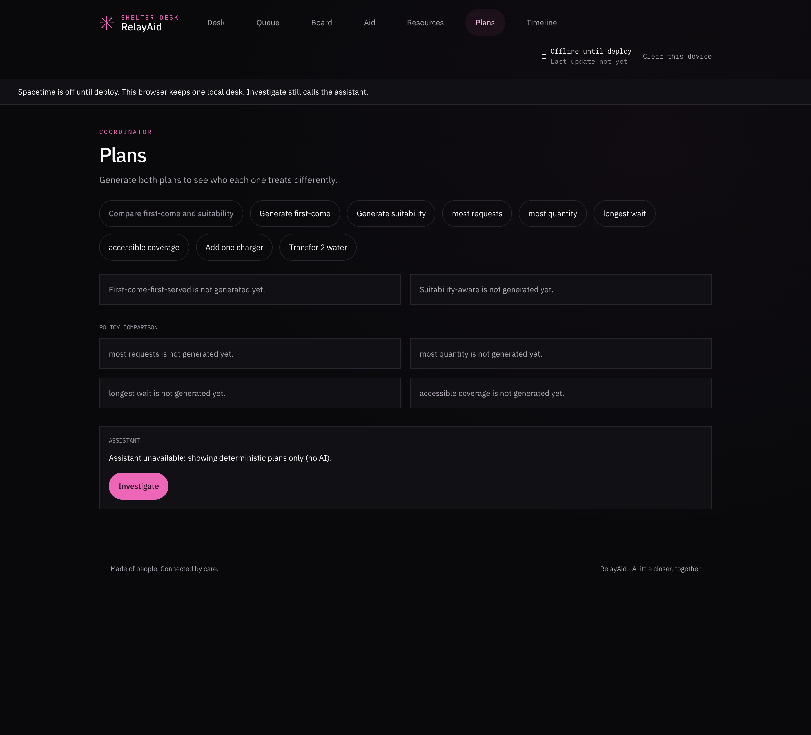
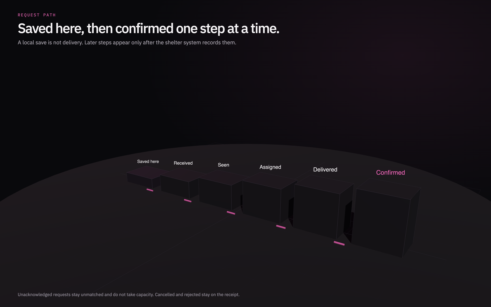
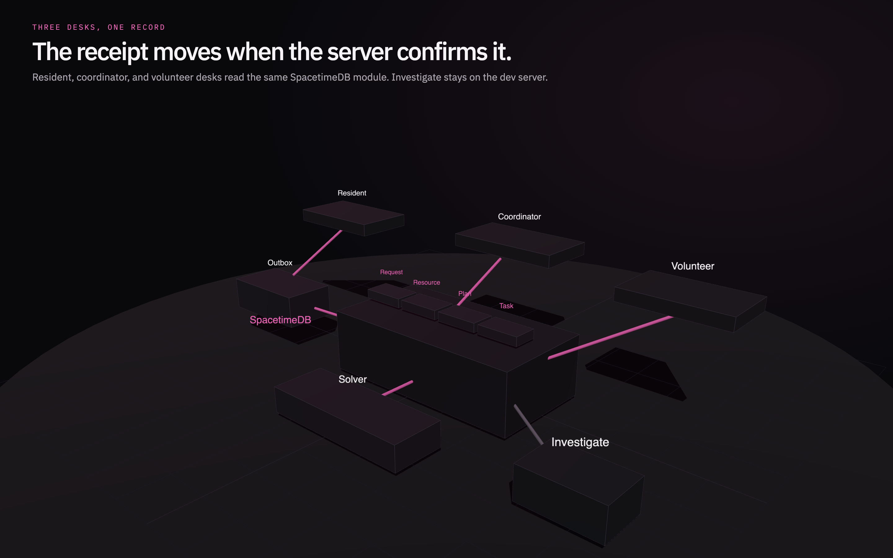
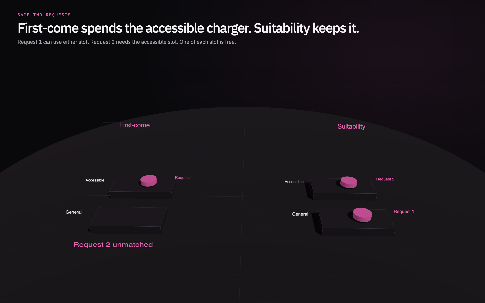
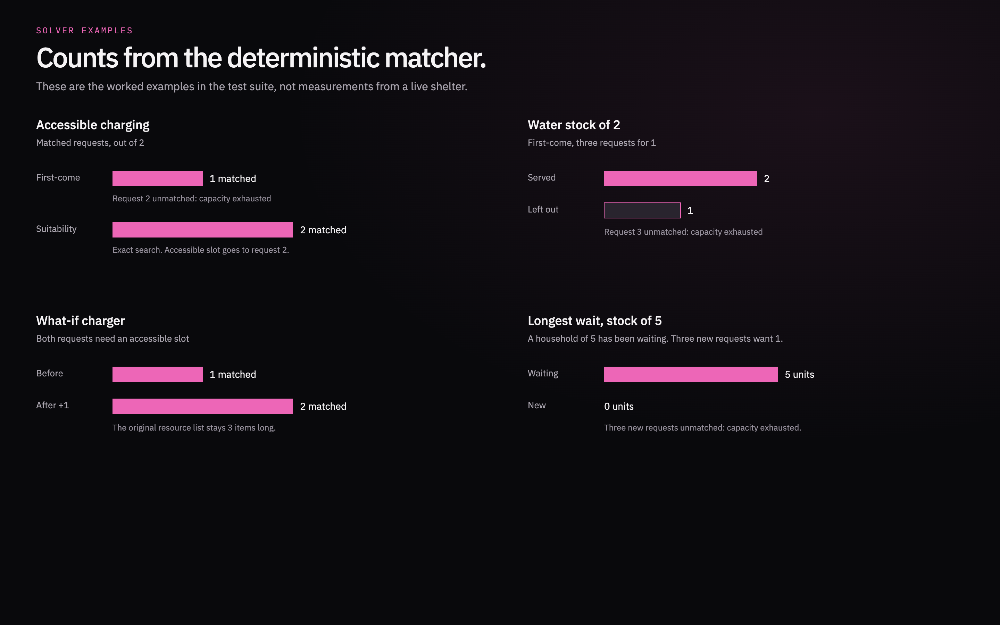

# RelayAid

A shelter desk for water and charging requests. The receipt only moves when the server confirms it.

Screenshots below are the local demo with Spacetime off. Charts and the allocation diagram are the deterministic matcher’s worked examples, not counts from a live shelter.

## The desk



This browser keeps one role. A second role needs another browser profile.









Until `VITE_SPACETIME_URI` is set, the coordinator list stays on “Connecting to the shelter system…” and plans are not generated yet.

## How a request moves



A save on the device is not delivery. Seen, assigned, delivered, and confirmed appear only after the shelter system records them. An unacknowledged request stays unmatched and does not take capacity.

## One record for three desks



Resident, coordinator, and volunteer desks read the same module. The outbox holds a request until it can be sent. The solver writes a plan from requests and resources. Investigate calls NVIDIA from the dev server. That key is not part of the browser bundle. The gray link is that server-side path.

## Matcher results

Same two charging requests. Request 1 can use either slot. Request 2 needs the accessible slot. One accessible slot and one general slot are free.





| Example | Result |
| --- | --- |
| First-come, two charging requests | 1 matched. Request 2 unmatched: capacity exhausted. Method: heuristic. |
| Suitability, same requests | 2 matched. Accessible slot goes to request 2. Method: exact. |
| First-come, water stock 2, three requests for 1 | Requests 1 and 2 served. Request 3 unmatched: capacity exhausted. |
| Both requests need an accessible slot | 1 matched. After a what-if adds one accessible charger, 2 matched. The original resource list stays 3 items long. |
| Longest wait, stock 5 | The waiting household of 5 is served. Three new requests for 1 are unmatched: capacity exhausted. Waiting adds 1 weight for every 30 minutes. That is a declared rule, not a claim of fairness. |

| Acknowledged requests | Suitability method |
| --- | --- |
| 2 or 12, default step budget | exact |
| 13, 20, or 50, stock enough for all | heuristic, all assigned |
| 2, step budget 1 | fallback, both still assigned |

First-come is always labeled heuristic. Shortage estimates stay unknown below 5 observations. Five observations valued 1, 2, 2, 3, and 4 estimate a range of 1 to 4. That range is not an arrival time.

## Run it

```bash
npm install
cd spacetimedb && npm install && npm run publish:local
cd .. && npm run dev
```

Open http://localhost:5173. Spacetime stays off until `VITE_SPACETIME_URI` is set at deploy time. Investigate uses `NEMOTRON_BASE_URL`, `NEMOTRON_API_KEY`, and `NEMOTRON_MODEL` in `.env`.

- Resident: `/r/request`
- Coordinator: `/c/queue`
- Volunteer: `/v/tasks`

## Checks

On this tree, `npm test` in `spacetimedb` passed 27 tests: 20 node tests and 7 module and access tests.
